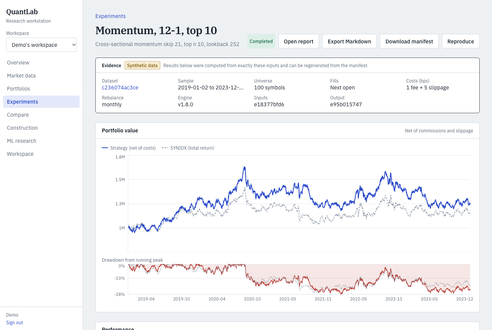
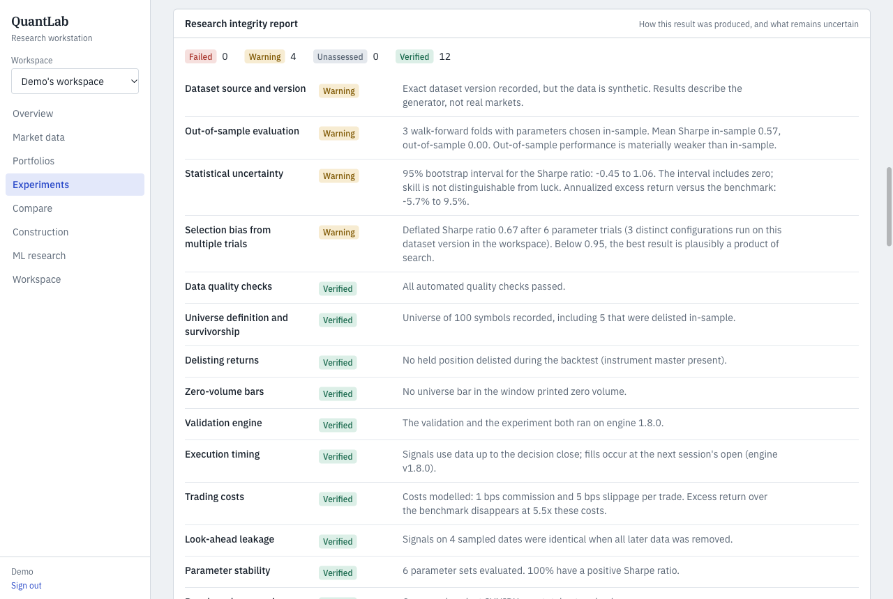
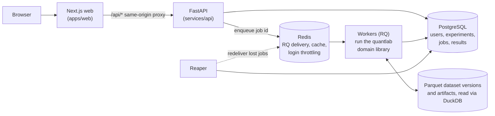

# QuantLab

QuantLab is a self-hosted platform for **reproducible quantitative research on equities**.
You version historical market data, define a strategy, run an event-driven backtest as a
background job, and get its performance, risk, statistical validation and an integrity
report. Every result can be reproduced exactly from its manifest.

**Status:** `v0.1.0-rc.3` is the final release candidate for private, self-hosted use. It
was verified from a fresh clone, with the evidence in
[docs/RELEASE_READINESS.md](docs/RELEASE_READINESS.md). Public deployment, licensed market
data and a hosted LLM are separate future work.

It is research infrastructure, not a trading bot. Results describe the past under stated
assumptions and are never investment advice. **All bundled data is synthetic**, and is
labelled synthetic on every screen, report and API response. A backtest on it shows how
the platform behaves, not that any strategy is profitable.



## The problem it addresses

A backtest is easy to write and easy to get wrong. The common failures are quiet:
* **Look-ahead.** A signal uses a price, a split or a delisting before it was public.
* **Survivorship.** The universe holds only stocks that still exist today.
* **Fills that couldn't happen.** At a decision-day close, through a trading halt, or on a
  zero-volume bar.
* **Statistics that hide their uncertainty.** Undefined ratios printed as 0. The best of
  many variants reported as if it were the only one.
* **Results nobody can regenerate.** The data, parameters or code changed silently.

QuantLab treats each of these as an engineering requirement with a test, rather than a
convention.

## What it does

| Area | Capability |
|---|---|
| Market data | NYSE trading calendar, raw OHLCV with availability timestamps, splits and dividends, point-in-time total-return adjustment, 23 quality checks, content-addressed immutable Parquet versions, permanent instrument identity across ticker changes, DuckDB retrieval with Redis caching |
| Backtesting | Daily event-driven engine: next-session fills, slippage, commissions, partial fills, no fills on zero-volume bars, point-in-time delistings, deterministic output fingerprints. Nine strategies, from buy-and-hold to minimum variance and risk parity |
| Accounting | Append-only transaction ledger with replay audit, value conservation and corporate actions; portfolios valued against a dataset version |
| Analytics | Return, risk-adjusted, benchmark-relative and drawdown statistics, with undefined values reported as undefined and a reason. Historical, Gaussian and Cornish-Fisher VaR/ES, factor exposures with Newey-West errors, stress scenarios, bootstrap Monte Carlo |
| Validation | Walk-forward with in-sample parameter selection, parameter and cost sweeps, bootstrap confidence intervals, deflated Sharpe ratio, regime breakdown, an engine-level look-ahead check, and a Research Integrity Report |
| Portfolio construction | Minimum variance, mean-variance and risk parity, long-only with weight caps, each solve validated (and a failed one accepted only with an optimality certificate) |
| ML research | Point-in-time features, purged and embargoed chronological cross-validation, models compared with simple baselines |
| Assistant and reports | A question box whose answers cite computed results and are checked against them before display; works without an LLM key ([eval](docs/AI_EVAL.md)); HTML and Markdown reports |
| Platform | FastAPI, Argon2id auth, workspaces with roles, audit log, durable Postgres-backed jobs (leases, fencing, retries, cancellation, timeouts, crash recovery), Prometheus metrics, OpenTelemetry traces from request to job |



## Architecture



* **`packages/quantlab`:** the domain library (data, engine, ledger, analytics, validation,
  ML, assistant). It imports no web or database code, so everything numerical is testable
  in isolation.
* **`services/api`:** HTTP routes, persistence and the job system. Routes never run a
  simulation: they validate the request, record a job in Postgres and enqueue its id.
* **PostgreSQL** is the source of truth for job state; Redis only delivers job ids
  (DECISIONS.md, ADR-0002). A lost message or a dead worker is recovered by the reaper,
  and a stale worker can't overwrite a newer attempt (fencing tokens, database-time
  leases).

More in [docs/ARCHITECTURE.md](docs/ARCHITECTURE.md), the formulas and conventions in
[docs/METHODOLOGY.md](docs/METHODOLOGY.md), and the decisions in [DECISIONS.md](DECISIONS.md).

## Run it

You need Docker, with at least 5 GiB of VM memory for the default stack (or
`QUANTLAB_WORKERS=1` on a smaller one; see [Development](docs/DEVELOPMENT.md)), plus
Python 3.12 with [uv](https://docs.astral.sh/uv/) and Node.js 22.

```bash
make setup     # install Python and web dependencies
make app-up    # build and start web, API, workers, reaper, Postgres and Redis
```

Open http://localhost:3000 and create an account. The [demo walkthrough](docs/DEMO.md)
takes about ten minutes: a synthetic dataset, a backtest, its validation and integrity
report, a reproduction, and portfolio construction.

**Local only.** Every port is bound to 127.0.0.1. Public exposure is prohibited until the
security gate #39 is closed (an edge verified on an address-preserving host); see
[RUNBOOK, Exposing a deployment](docs/RUNBOOK.md#exposing-a-deployment).

## How it is verified

* **Hand-computed cases.** Backtests checked against arithmetic done by hand, and
  corporate-action and delisting cases with known answers.
* **An independent reference engine.** `tests/oracle/reference.py` is written from the
  methodology and imports nothing from the engine. The engine must agree with it to 1e-9
  on 50 seeded synthetic universes (200 in the slow mode), which combine halts, splits,
  dividends, delistings, ticker reuse and short cash.
* **Mutation testing.** `tests/oracle/mutate.py` injects 36 known defects (one-bar
  look-ahead, fills at the wrong price, delisting a day early, and so on). The suites must
  catch each one.
* **A/B records.** Every engine change is compared with the previous engine on 1,002 runs,
  and every changed run is attributed.
* **Look-ahead checks.** Decisions must not change when all later data is removed.
* **Unit, integration and browser tests.** Unit and property tests for the library;
  integration tests against real Postgres and Redis (authorization matrix, migrations, job
  failure injection); Playwright end-to-end with an axe WCAG 2.1 AA audit and a layout
  check at desktop and phone widths.
* **Two audits.** Their findings are in [docs/AUDIT_2026-10-30.md](docs/AUDIT_2026-10-30.md)
  and [docs/AUDIT_2026-11-07.md](docs/AUDIT_2026-11-07.md).

What each layer covers is in [docs/TEST_MATRIX.md](docs/TEST_MATRIX.md); how to run them in
[docs/DEVELOPMENT.md](docs/DEVELOPMENT.md).

## Limitations

* **No real market data is configured.** The CSV importer accepts data whose licence permits
  local research use. A licensed vendor adapter exists as a fixture-tested contract, and
  needs credentials to go live (docs/MARKET_DATA_PROVIDERS.md).
* **The assistant** uses a deterministic, citation-checked answerer by default. A hosted LLM
  is optional and has not been evaluated with a key (docs/AI_EVAL.md).
* **Not publicly deployed.** It is a private, self-hosted application. Public deployment
  waits on #39 and an account-lifecycle decision (#168); the AWS Terraform is validated and
  has never been applied.
* **Measured on one machine.** Performance figures come from one developer Mac
  ([docs/BENCHMARKS.md](docs/BENCHMARKS.md)), not from a server.
* **Daily bars only.** No leverage or shorting is modelled, and cash earns nothing. The full
  list is in METHODOLOGY, *Known limitations*.

## Documentation

| | |
|---|---|
| [docs/DEMO.md](docs/DEMO.md) | A ten-minute walkthrough and a suggested order for a technical demo |
| [docs/ENGINEERING_CASE_STUDY.md](docs/ENGINEERING_CASE_STUDY.md) | Difficult problems in building it, and how they were solved and verified |
| [docs/CASE_STUDY.md](docs/CASE_STUDY.md) | One research question taken through the whole workflow |
| [docs/METHODOLOGY.md](docs/METHODOLOGY.md) | Every formula, convention and known limitation |
| [docs/ARCHITECTURE.md](docs/ARCHITECTURE.md) · [DECISIONS.md](DECISIONS.md) | Components, data flow, security model; architecture decision records |
| [docs/RUNBOOK.md](docs/RUNBOOK.md) | Operating it: resources, failure modes, recovery |
| [docs/DEVELOPMENT.md](docs/DEVELOPMENT.md) · [docs/TEST_MATRIX.md](docs/TEST_MATRIX.md) | Working on it; what the tests cover |
| [docs/RELEASE_READINESS.md](docs/RELEASE_READINESS.md) · [STATUS.md](STATUS.md) | Release evidence; current state |
